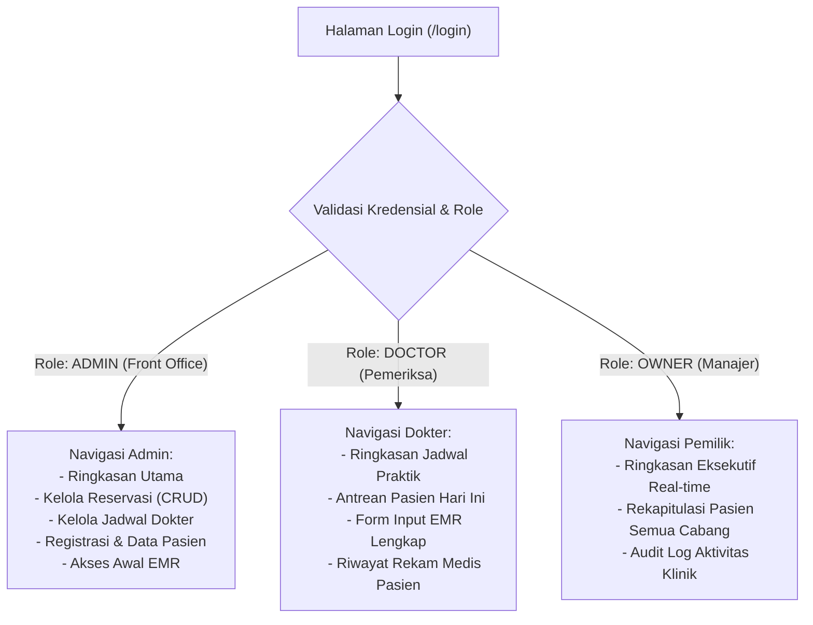
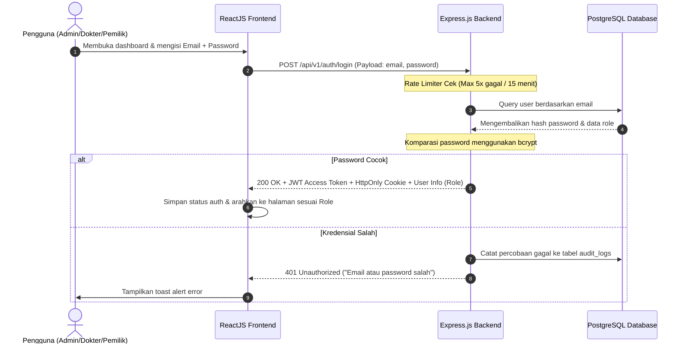
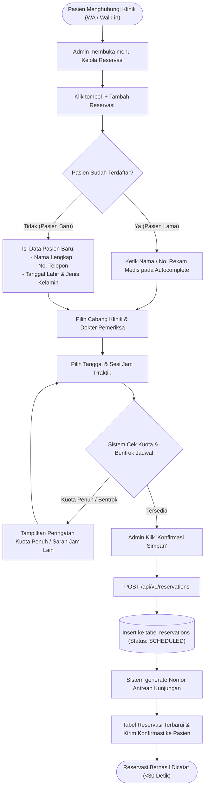
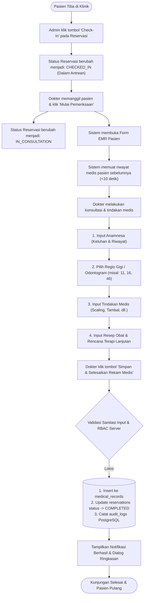
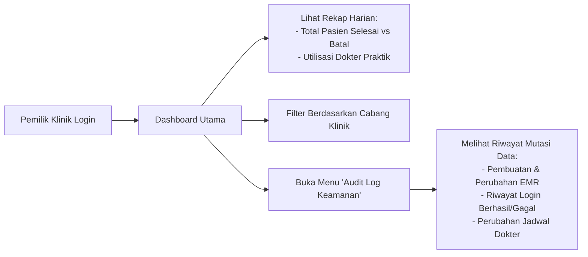
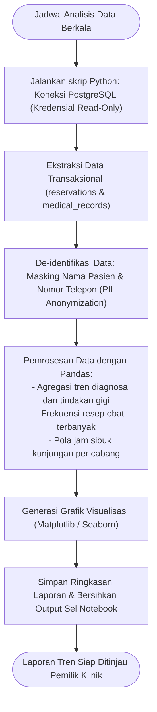
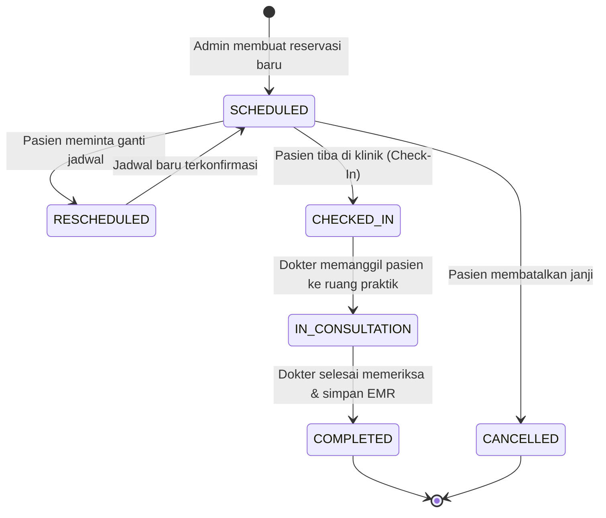
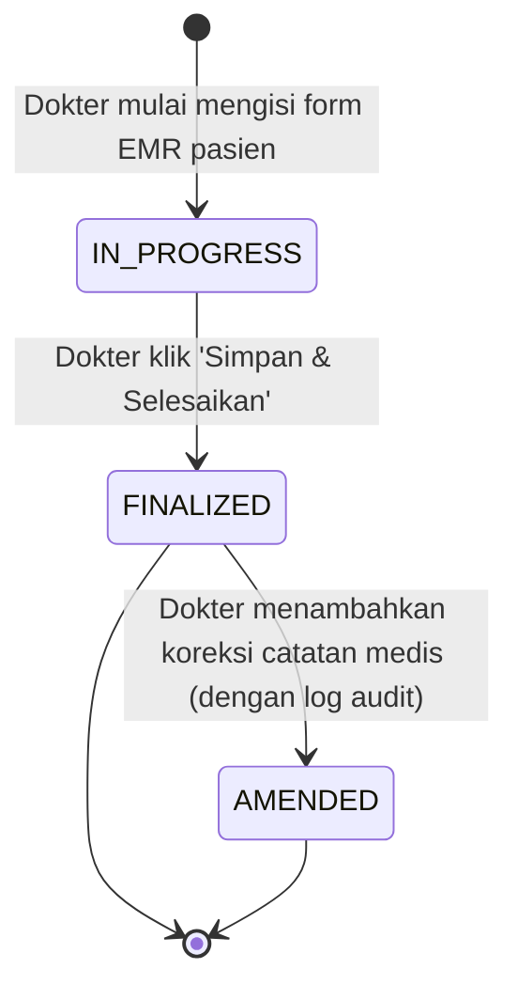

# Alur Aplikasi & Siklus Pengguna (Application & User Flow)

Dokumen ini mendefinisikan seluruh alur kerja operasional, perjalanan pengguna (*user journeys*), siklus hidup data, serta interaksi sistem antara **Frontend (ReactJS)**, **Backend (Node.js & Express.js)**, dan **Database (PostgreSQL)** pada ekosistem **IN DENTAL CARE Admin Dashboard**.

Dokumen ini berfungsi sebagai peta acuan bagi pengembang dan AI Agent untuk memahami urutan logika (*step-by-step logic*) di balik setiap aksi pengguna, mencegah ambiguitas alur kerja klinik gigi, serta menjadi jembatan antara [prd_in_dental_care_admin_dashboard.md](file:///c:/Users/ASUS/OneDrive/Documents/GitHub/DentalCare-Dashboard/panduan/prd_in_dental_care_admin_dashboard.md), [apiguide.md](file:///c:/Users/ASUS/OneDrive/Documents/GitHub/DentalCare-Dashboard/panduan/apiguide.md), dan [security.md](file:///c:/Users/ASUS/OneDrive/Documents/GitHub/DentalCare-Dashboard/panduan/security.md).

---

## 1. Peta Navigasi Global Berdasarkan Persona

Sistem membedakan alur navigasi dan hak akses antarmuka berdasarkan tiga persona utama sesuai spesifikasi PRD:

---

## 2. Alur 1: Autentikasi, Verifikasi Token, & Manajemen Sesi

Alur ini mengamankan pintu masuk sistem dashboard sesuai kebutuhan **FR-1**, **US-1**, dan standar keamanan pada [security.md](file:///c:/Users/ASUS/OneDrive/Documents/GitHub/DentalCare-Dashboard/panduan/security.md).

### 2.1. Alur Kerja Login & Pengalihan Sesi

### 2.2. Aturan Sesi & Route Protection
* **Pengecekan Token Berkala:** Setiap perpindahan tab atau pengiriman request API menyertakan header `Authorization: Bearer <token>`.
* **Token Expired (401):** Jika token kedaluwarsa, axios interceptor di ReactJS otomatis menghapus state lokal pengguna dan mengalihkan layar ke `/login` dengan notifikasi *"Sesi Anda telah berakhir, silakan masuk kembali."*

---

## 3. Alur 2: Manajemen Reservasi & Penjadwalan Dokter

Alur ini memusatkan pencatatan reservasi pasien (baik dari pesan WhatsApp maupun pasien datang langsung / *walk-in*) serta mengatur kuota praktik dokter lintas cabang sesuai **FR-3**, **FR-6**, **US-3**, dan **US-4**.

### 3.1. Alur Pendaftaran Reservasi Baru

### 3.2. Alur Reschedule & Pembatalan (Cancellation)
1. **Penjadwalan Ulang (Reschedule):**
   * Admin membuka detail reservasi $\rightarrow$ klik **"Reschedule"**.
   * Admin memilih tanggal/jam baru dokter yang sama atau mengganti dokter lain.
   * Backend memverifikasi ketersediaan jadwal baru $\rightarrow$ memperbarui status reservasi menjadi `RESCHEDULED`.
2. **Pembatalan (Cancel):**
   * Pasien konfirmasi batal $\rightarrow$ Admin mengubah status menjadi `CANCELLED`.
   * Sistem otomatis mengembalikan kuota dokter pada slot waktu yang dibatalkan.

---

## 4. Alur 3: Kunjungan Pasien & Pengisian Rekam Medis Elektronik (EMR)

Alur inti klinis dokter untuk memeriksa pasien dan mencatat riwayat medis secara real-time sesuai **FR-7**, **US-5**, dan **US-6**.

---

## 5. Alur 4: Pemantauan Operasional & Audit Log oleh Pemilik Klinik

Alur bagi Pemilik Klinik / Manajer untuk memantau performa harian dan keamanan sistem sesuai kebutuhan **Persona 3** dan **US-2**.

---

## 6. Alur 5: Siklus Modul Analitik Data (Python & Jupyter Notebook)

Alur ekstraksi dan pengolahan data klinik untuk menghasilkan wawasan bisnis mendalam sesuai **FR-5** dan **US-7**.

---

## 7. Diagram Mesin Status Data (State Machine Diagrams)

### 7.1. Siklus Hidup Status Reservasi Pasien (`reservations.status`)

### 7.2. Siklus Hidup Rekam Medis Elektronik (`medical_records.status`)

---

## 8. Penanganan Skenario Tepi & Error Operasional (Edge Cases)

| Skenario Anomali / Tepi | Dampak pada Sistem | Prosedur Solusi Sistem (Fallback & Recovery) |
| :--- | :--- | :--- |
| **Dokter Berhalangan Mendadak** | Jadwal praktik aktif memiliki 10 reservasi pasien hari itu. | Sistem menandai dokter sebagai `UNAVAILABLE`. Admin menerima notifikasi peringatan untuk melakukan *mass-reschedule* atau pengalihan pasien ke dokter pengganti di cabang yang sama. |
| **Koneksi Internet Terputus Saat Input EMR** | Form EMR yang sedang diisi berisiko hilang. | Frontend ReactJS menerapkan penyimpanan sementara di *Local Cache/IndexedDB*. Saat koneksi pulih, tombol simpan aktif kembali tanpa kehilangan data anamnesa/resep. |
| **Sesi Token Habis Saat Form EMR Terbuka** | Request simpan ditolak dengan status HTTP `401`. | Modal autentikasi ulang (*Re-authentication modal*) muncul di atas form EMR tanpa melakukan reload halaman, sehingga data yang sudah diketik tidak hilang. |
| **Pasien Walk-in Tanpa Kontak WA** | Data nomor telepon kosong. | Sistem mengizinkan kolom kontak opsional dengan mencentang opsi *"Pasien Walk-in Offline"*, namun ID pasien dan nomor rekam medis tetap dibuat otomatis di PostgreSQL. |

