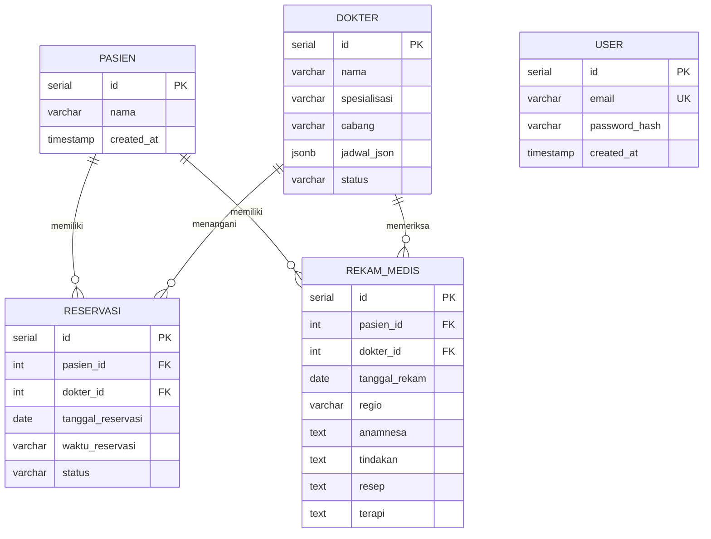

# Dokumentasi Basis Data (database.md)

Dokumen ini berisi spesifikasi skema basis data relasional **PostgreSQL** resmi untuk aplikasi **IN DENTAL CARE Admin Dashboard**. Seluruh struktur tabel dan penamaan kolom menggunakan **Bahasa Indonesia** yang sederhana, terarah, dan sesuai dengan kebutuhan nyata proyek.

---

## 1. Ringkasan Tabel Proyek

Sistem ini hanya menggunakan **5 tabel utama** tanpa penambahan tabel atau kolom yang tidak diperlukan:

1. **`user`**: Menyimpan kredensial email dan password terenkripsi untuk login ke dashboard.
2. **`dokter`**: Menyimpan master data dokter, cabang tempat bertugas, dan konfigurasi jadwal praktik fleksibel (`jadwal_json`).
3. **`pasien`**: Menyimpan data identitas pasien berobat.
4. **`reservasi`**: Mencatat jadwal pemesanan konsultasi pasien dengan dokter terkait status kunjungan.
5. **`rekam_medis`**: Menyimpan data Rekam Medis Elektronik (EMR) hasil konsultasi pasien (regio gigi, anamnesa, tindakan, resep, dan terapi).

---

## 2. Diagram Relasi Antar Tabel (ERD)



---

## 3. Rincian Skema Tabel

### 3.1. Tabel: `user`
Menyimpan data pengguna untuk autentikasi ke dalam dashboard.

* `id` (`SERIAL`, Primary Key)
* `email` (`VARCHAR`, Unique, Not Null) — Alamat email login
* `password_hash` (`VARCHAR`, Not Null) — Menyimpan string hasil hashing password (bcrypt)
* `created_at` (`TIMESTAMP`, Default `CURRENT_TIMESTAMP`)

---

### 3.2. Tabel: `dokter`
Menyimpan data dokter gigi dan jadwal fleksibelnya.

* `id` (`SERIAL`, Primary Key)
* `nama` (`VARCHAR`, Not Null) — Nama lengkap dokter gigi
* `spesialisasi` (`VARCHAR`) — Spesialisasi bidang medis gigi
* `cabang` (`VARCHAR`) — Lokasi cabang klinik (Contoh: Garuda, Muchtar Raya)
* `jadwal_json` (`JSONB`) — Menyimpan konfigurasi hari & jam praktik fleksibel
* `status` (`VARCHAR`) — Status dokter (misal: Aktif / Tidak Aktif)

---

### 3.3. Tabel: `pasien`
Menyimpan data pasien klinik gigi.

* `id` (`SERIAL`, Primary Key)
* `nama` (`VARCHAR`, Not Null) — Nama lengkap pasien
* `created_at` (`TIMESTAMP`, Default `CURRENT_TIMESTAMP`)

---

### 3.4. Tabel: `reservasi`
Mencatat antrean janji temu pasien dengan dokter pemeriksa.

* `id` (`SERIAL`, Primary Key)
* `pasien_id` (`INT`, Foreign Key references `pasien(id)`)
* `dokter_id` (`INT`, Foreign Key references `dokter(id)`)
* `tanggal_reservasi` (`DATE`, Not Null) — Tanggal janji temu
* `waktu_reservasi` (`VARCHAR`, Not Null) — Sesi jam janji temu
* `status` (`VARCHAR`) — Status reservasi (*Appointment* atau *Reschedule*)

---

### 3.5. Tabel: `rekam_medis`
Menyimpan catatan medis pemeriksaan gigi (EMR).

* `id` (`SERIAL`, Primary Key)
* `pasien_id` (`INT`, Foreign Key references `pasien(id)`)
* `dokter_id` (`INT`, Foreign Key references `dokter(id)`)
* `tanggal_rekam` (`DATE`, Not Null) — Tanggal pemeriksaan
* `regio` (`VARCHAR`) — Nomor gigi / area (odontogram)
* `anamnesa` (`TEXT`) — Keluhan utama dan riwayat penyakit pasien
* `tindakan` (`TEXT`) — Tindakan penanganan medis yang dilakukan
* `resep` (`TEXT`) — PF (Resep obat yang diberikan)
* `terapi` (`TEXT`) — Rencana anjuran dan terapi lanjutan

---

## 4. Konfigurasi Koneksi Database (Node.js & Express.js)

Koneksi database PostgreSQL di backend diatur menggunakan `pg` pool sederhana di file `backend/config/db.js`:

```javascript
// backend/config/db.js
const { Pool } = require('pg');

const pool = new Pool({
  connectionString: process.env.DATABASE_URL,
  max: 10,
  idleTimeoutMillis: 30000,
  connectionTimeoutMillis: 5000
});

module.exports = {
  query: (text, params) => pool.query(text, params),
  pool
};
```

---

## 5. Skrip SQL (DDL) Pembuatan Tabel

Skrip SQL berikut dapat langsung dijalankan di PostgreSQL untuk membuat ke-5 tabel proyek:

```sql
-- 1. Tabel user
CREATE TABLE IF NOT EXISTS "user" (
    id SERIAL PRIMARY KEY,
    email VARCHAR(255) NOT NULL UNIQUE,
    password_hash VARCHAR(255) NOT NULL,
    created_at TIMESTAMP DEFAULT CURRENT_TIMESTAMP
);

-- 2. Tabel dokter
CREATE TABLE IF NOT EXISTS dokter (
    id SERIAL PRIMARY KEY,
    nama VARCHAR(255) NOT NULL,
    spesialisasi VARCHAR(255),
    cabang VARCHAR(255),
    jadwal_json JSONB,
    status VARCHAR(50) DEFAULT 'Aktif'
);

-- 3. Tabel pasien
CREATE TABLE IF NOT EXISTS pasien (
    id SERIAL PRIMARY KEY,
    nama VARCHAR(255) NOT NULL,
    created_at TIMESTAMP DEFAULT CURRENT_TIMESTAMP
);

-- 4. Tabel reservasi
CREATE TABLE IF NOT EXISTS reservasi (
    id SERIAL PRIMARY KEY,
    pasien_id INT NOT NULL REFERENCES pasien(id) ON DELETE CASCADE,
    dokter_id INT NOT NULL REFERENCES dokter(id) ON DELETE CASCADE,
    tanggal_reservasi DATE NOT NULL,
    waktu_reservasi VARCHAR(100) NOT NULL,
    status VARCHAR(50) DEFAULT 'Appointment'
);

-- 5. Tabel rekam_medis
CREATE TABLE IF NOT EXISTS rekam_medis (
    id SERIAL PRIMARY KEY,
    pasien_id INT NOT NULL REFERENCES pasien(id) ON DELETE CASCADE,
    dokter_id INT NOT NULL REFERENCES dokter(id) ON DELETE CASCADE,
    tanggal_rekam DATE NOT NULL DEFAULT CURRENT_DATE,
    regio VARCHAR(100),
    anamnesa TEXT,
    tindakan TEXT,
    resep TEXT,
    terapi TEXT
);

-- Indeks untuk mempercepat pencarian data
CREATE INDEX IF NOT EXISTS idx_reservasi_tanggal ON reservasi (tanggal_reservasi);
CREATE INDEX IF NOT EXISTS idx_rekam_medis_pasien ON rekam_medis (pasien_id);
```
